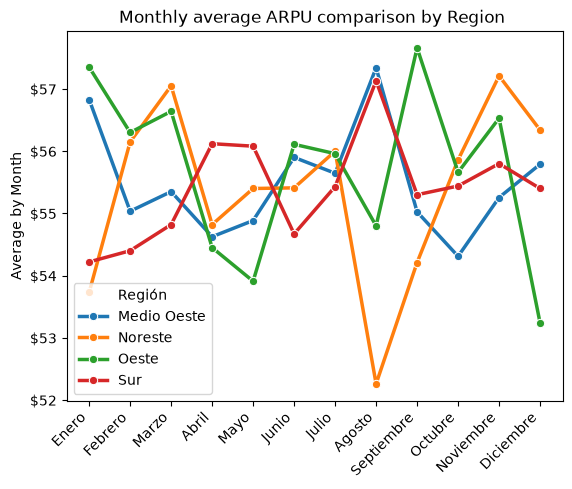

# Cellphone Service by Region Review

## Initial Assestment

This initial assestment includes the review by region of cellphone service revenue by user (ARPU_USD) accross several regions to review the monthly trend.
For this review was the data was arranged by region and month with the following code: 

``` python
df_telco_piv = df_telco.pivot_table(values='ARPU_USD', index='Mes', columns='Región', aggfunc='median')
```

After the initial arrangement, the data was scattered with no proper format (months not arranged properly on sequencial order), this required multiple steps to be arranged accordingly:
1. Created a new dictionary temporally to match months name with the proper month noumber: 

``` python 
# Dict to create month matrix
meses_dict = {
    'Enero': 1,
    'Febrero': 2,
    'Marzo': 3,
    'Abril': 4,
    'Mayo': 5,
    'Junio': 6,
    'Julio': 7,
    'Agosto': 8,
    'Septiembre': 9,
    'Octubre': 10,
    'Noviembre': 11,
    'Diciembre': 12,
}

#reset index 

df_telco_piv = df_telco_piv.reset_index()

# new column with month #
df_telco_piv['Mes_no'] = (
    df_telco_piv['Mes'].str.strip().str.capitalize().map(meses_dict)
```

2. After the new column added with the month number using a new dictionary (just for practice purposes since could be done as well with code to get the month #), the next step was to sort by month number, remove the month number column and reset the index to align properly now that the months have been sorted properly and show in chronological order.

``` python
# 1. order ascending by month
df_telco_piv = df_telco_piv.sort_values(by='Mes_no', ascending=True)

# 2. remove month no column
df_telco_piv = df_telco_piv.drop(columns='Mes_no')

# 3. reset index
df_telco_piv = df_telco_piv.reset_index(drop=True)
```

3. After the proper arrangement the information was plotted using seaborn library for a more customazible view on the file using the following code: 

``` python
df_melted = df_telco_piv.melt(id_vars=['Mes'], var_name='Región', value_name='Valor')

# graph using melt pointing to value named 'Valor'
sns.lineplot(data=df_melted, x='Mes', y='Valor', hue='Región', marker='o', linewidth=2.5)
plt.title('Monthly average ARPU comparison by Region ')
plt.xlabel('')
plt.ylabel('Average by Month')
plt.xticks(rotation=45, ha='right')
ax=plt.gca()
#change format on y axis to include $ USD format.
ax.yaxis.set_major_formatter(plt.FuncFormatter(lambda y, pos: f'${int(y)}'))
plt.show()
```

With this code I customized the title, x label blank, y label renamed and adjusted x series to show the name rotated for proper sizing on the view, as well the format was changed on the Y axis to show with the proper USD$ format.

